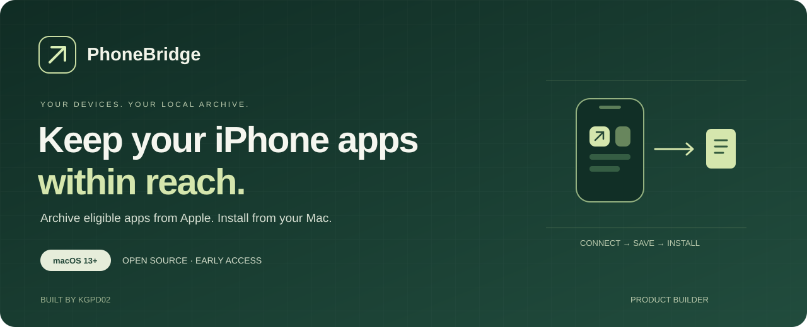
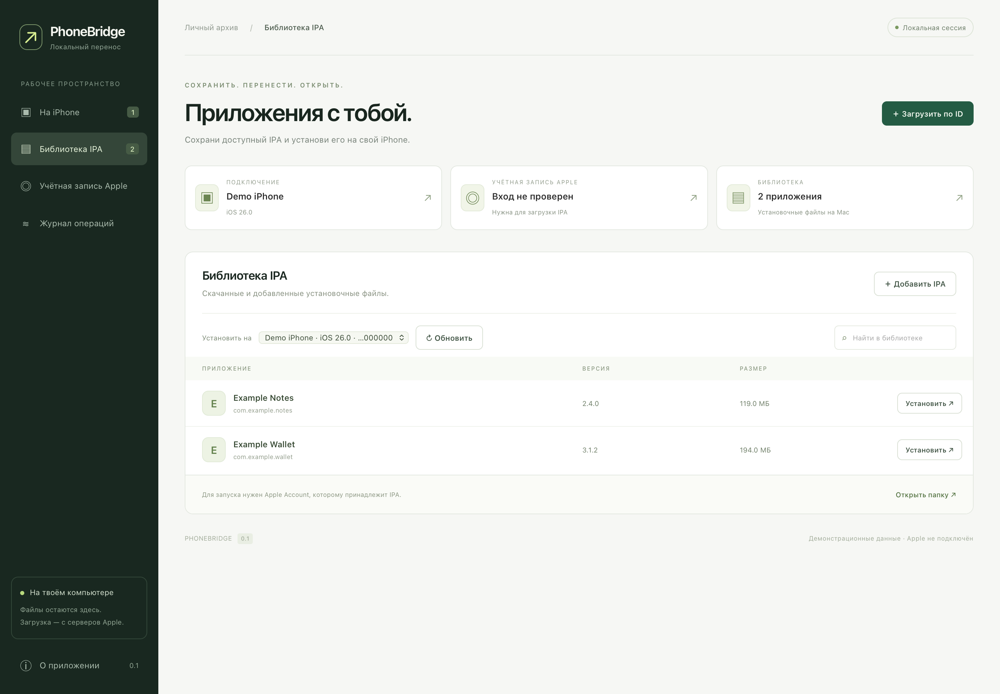

<p align="center">
  
</p>

<p align="center">
  <a href="https://github.com/kgpd02/phonebridge/releases"><strong>Download for macOS ↗</strong></a> ·
  <a href="README.ru.md">На русском</a> · <a href="docs/INSTALL.ru.md">Установка</a> ·
  <a href="docs/CASE-STUDY.md">Product case study</a>
</p>

<p align="center">
  
  
  <a href="LICENSE"></a>
  
</p>

**PhoneBridge is an open-source macOS app for archiving and reinstalling iPhone apps.** Read an iPhone's app list, download an eligible IPA from Apple, and keep it in a local library for installation on your own device.

Some apps disappear from App Store search while remaining eligible for download under an existing Apple Account license. PhoneBridge reads their numeric App Store IDs from the old iPhone's metadata and uses those IDs for the download.

Built by **[kgpd02 · Product Builder](https://github.com/kgpd02)**. From a real migration problem to a working macOS product, with AI-assisted implementation and hands-on validation. [Read the build story →](docs/CASE-STUDY.md)



*Actual frontend with demonstration data. No Apple account or device data is shown.*

## A short path from old phone to local archive

| Step | What you do | What PhoneBridge does |
| --- | --- | --- |
| **1. Connect** | Connect and unlock the old iPhone. | Read installed apps, versions and App Store IDs over USB. |
| **2. Save** | Sign in to the Apple Account that owns the app. | Request an eligible IPA directly from Apple and verify its bundle identifier. |
| **3. Install** | Choose an activated target iPhone. | Install a saved IPA after you confirm the selected device. |

The library supports local IPA import, SHA-256 deduplication and an operation log. Downloads use an existing license. Automatic purchases are disabled.

## Install

1. Download the **DMG** from [Releases](https://github.com/kgpd02/phonebridge/releases).
2. Open the DMG.
3. Drag **PhoneBridge** into **Applications**.
4. Open **PhoneBridge**.
5. Select **О приложении → Подготовить подключение** to download the device connection dependencies.

The app includes Python for Apple Silicon and Intel. Initial device setup and Apple sign-in need internet access. The interface is currently in Russian.

**Signing:** this early-access build uses a local ad-hoc signature. It has no Apple Developer ID signature or notarization. macOS may block its first launch. See the [installation guide](docs/INSTALL.ru.md) and [Apple's opening guidance](https://support.apple.com/102445).

## What works today

- USB device discovery and installed-app metadata were tested with a physical iPhone on iOS 26.
- Apple Account sign-in and two-factor authentication were tested with a real account.
- Two delisted apps were downloaded from Apple by numeric App Store ID. Their identifiers and versions matched the old iPhone.
- Automated checks cover archive validation, path protection, wrong-app rejection, download arguments, credential handling and localhost API access.
- The packaged Python runtime was tested independently of the developer's Python installation.

**Installation on a second physical iPhone has not yet been validated.** Treat this release as early access. The app includes an installation path through pymobiledevice3, but successful download does not guarantee installation or launch on every iOS version. Intel binaries are included; a physical Intel Mac has not been tested.

## Know the boundary

PhoneBridge cannot recover an installable IPA from a modern iPhone's installed app files. It downloads from Apple or imports an IPA you already have. Apple determines whether a delisted app is still available to your account.

An IPA contains the app package. App data, banking sessions, passwords and messages require a separate migration. PhoneBridge does not bypass app licensing, re-sign apps with a developer certificate, erase devices or restore whole-device backups.

## Your account and files

- The UI and backend run locally. The HTTP server binds only to `127.0.0.1` and requires a random per-launch API token.
- The app UI loads no remote scripts, fonts or analytics.
- Apple authentication is performed by [ipatool](https://github.com/majd/ipatool). It stores account credentials, **including the password used to refresh the session**, in macOS Keychain. Cookies are stored locally. An encrypted-file fallback may be offered if Keychain is unavailable.
- Our code does not write passwords or verification codes to logs or process arguments.
- IPA files and device dependencies are stored in `~/Library/Application Support/PhoneBridge/`.
- GitHub releases contain no user IPA files, Apple cookies, saved sessions or device inventories.

See [architecture and data handling](docs/ARCHITECTURE.md) for the details.

## Build from source

Requires macOS, Xcode Command Line Tools and Python 3.12 or newer. The build fetches pinned Python and ipatool archives from their upstream GitHub releases and verifies SHA-256 before extraction.

```sh
git clone https://github.com/kgpd02/phonebridge.git
cd phonebridge
python3 scripts/build.py
python3 scripts/package.py
```

The app and DMG appear in `dist/`. For the backend checks:

```sh
PYTHONDONTWRITEBYTECODE=1 python3 -m unittest discover -s tests -v
```

See [CONTRIBUTING.md](CONTRIBUTING.md) for structure, development and review expectations.

## Built on open source

| Component | Role | License |
| --- | --- | --- |
| Swift / AppKit / WebKit | Native macOS window and local UI | PhoneBridge code: GPL-3.0-or-later |
| [ipatool 2.7.0](https://github.com/majd/ipatool) | Apple authentication and IPA downloads | MIT |
| [pymobiledevice3 11.43.1](https://github.com/doronz88/pymobiledevice3) | USB app inventory and installation | GPL-3.0-or-later |
| [python-build-standalone](https://github.com/astral-sh/python-build-standalone) | Bundled CPython runtime | Upstream component licenses |

License notices and available source archives are in [`third_party/`](third_party/). Runtime archives include their upstream license notices. PhoneBridge is not affiliated with Apple or any bank.

## About the builder

**[kgpd02 · Product Builder](https://github.com/kgpd02)**

I build practical tools around concrete user problems. PhoneBridge documents the full path: problem framing, product boundaries, implementation, real-device feedback and release packaging.

Have a reproducible issue or a useful next step? [Open an issue](https://github.com/kgpd02/phonebridge/issues). Please omit account details, device identifiers and authentication codes.
