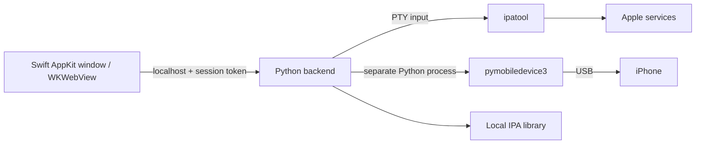

# Architecture and data handling

The UI is HTML/CSS/JavaScript inside a native WebKit view. The launcher starts the bundled Python runtime. The backend exposes a small allowlisted HTTP API on a random loopback port.

## Data locations

The default data root is `~/Library/Application Support/PhoneBridge/`.

| Location | Contents |
| --- | --- |
| `Library/` | User-imported and downloaded IPA files and metadata sidecars |
| `private/venv/` | Device connection dependencies installed from PyPI |
| `private/state/` | ipatool state, including cookies where used by upstream |
| macOS Keychain | ipatool's stored account credentials, including refresh password |
| `~/Library/Caches/ipatool/` | Upstream authentication helper assets |

`PHONEBRIDGE_DATA_DIR` overrides the data root for development and isolated tests. The app launcher sets this path explicitly. Build and release scripts copy only allowlisted source and upstream dependencies. They never copy the data root.

## Local API boundary

- Bind only to `127.0.0.1`.
- Require the expected Host and reject a different Origin.
- Require `X-PhoneBridge-Token` for API access.
- Generate a fresh token at each launch.
- Serve only the explicit frontend asset allowlist.
- Reject oversized request bodies.
- Load no external UI assets or analytics.
- Stop the backend after the UI heartbeat expires.

This is a boundary against unrelated websites and accidental access. A process already running with the same macOS user privileges is outside that threat model.

## Authentication

PhoneBridge launches upstream ipatool with a pseudo-terminal. Email, password and verification-code input travel through its standard input, not command arguments. Our operation log does not record those answers. WebKit uses a nonpersistent data store.

Upstream ipatool persists credentials in Keychain to refresh authentication. PhoneBridge does not present the flow as password-free storage. Account revocation uses ipatool's logout operation. Shared upstream state may also affect other programs using the same ipatool account storage.

## IPA handling

PhoneBridge reads ZIP metadata without extracting the archive. It checks the main app plist, size and entry limits, computes a SHA-256 hash and uses that hash for deduplication. A requested bundle identifier must match the returned package before it enters the library.

Library paths reject traversal and symlinks. The install action requires an explicit device identifier. Downloads omit automatic license acquisition. There is no erase, device restore or app removal action.

## Build and dependencies

The universal Swift launcher chooses an included arm64 or x86_64 Python runtime. The backend itself uses the standard library. Device access dependencies are installed into a separate virtual environment on first setup.

Runtime and ipatool archive URLs and hashes are pinned in `third_party/runtime-manifest.json`. Dependency installation from PyPI is explicit. Upstream ipatool may download its own authentication helper assets at first sign-in.

The early-access app is ad-hoc signed. It is not notarized. No certificate validation or macOS security feature is disabled by the build or installer.
